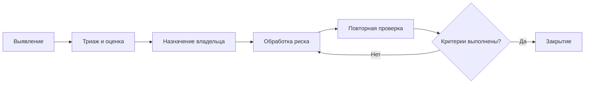

# Модуль B | Оценка безопасности банковского микросервиса

Учебный проект по защите ИТ-инфраструктуры. Объект исследования — сервис денежных переводов между счетами и получения истории транзакций. Работа посвящена анализу архитектуры, моделированию угроз и организации контроля безопасности на этапах разработки и эксплуатации.

**Границы работы:** исходный код приложения не изменяется. Контрмеры предлагаются в качестве рекомендаций; их внедрение и динамическая эксплуатация уязвимостей не проводятся.

## Навигация по проекту

| Направление | Материалы |
|---|---|
| Исходное приложение | [microservice/](microservice/) |
| Архитектура, DFD и оценка угроз | [threat-model/README.md](threat-model/README.md) |
| Модель угроз в формате Threat Dragon | [JSON](threat-model/threat_dragon_model.json) · [PDF](threat-model/threat-dragon-report.pdf) |
| Статический анализ и триаж | [static-analysis/README.md](static-analysis/README.md) |
| Процесс управления уязвимостями | [vulnerability-management.md](security-assessment/vulnerability-management.md) |
| Сводный аналитический отчёт | [security-assessment-report.pdf](security-assessment/security-assessment-report.pdf) |
| Автоматизация проверки | [security-tools/](security-tools/) |

## 1. Что анализируется

Внешний клиент взаимодействует с REST API на Python/FastAPI. Постоянное хранение счетов и операций реализовано через PostgreSQL. Для работы с кешем истории предусмотрен Redis. Конфигурация компонентов описана в Docker Compose.

| Элемент | Назначение | Защищаемые данные или функции |
|---|---|---|
| Пользователь | Отправка запросов к API | Идентичность и права доступа |
| FastAPI | Обработка переводов и запросов истории | Авторизация, бизнес-логика операций |
| PostgreSQL | Постоянное хранение | Балансы, счета, транзакции |
| Redis | Кеширование истории | Конфиденциальность и актуальность данных |

Модель DFD учитывает шесть направленных потоков обмена данными и две логические границы доверия: между клиентом и API, а также между API и хранилищами. Наличие границы на диаграмме не означает, что соответствующая сетевая изоляция уже реализована.

## 2. Результаты моделирования угроз

Для классификации используется STRIDE. Приоритет определяется произведением экспертных оценок вероятности и ущерба (от 1 до 5). Это внутренняя шкала рисков, а не CVSS.

| Приоритетная угроза | STRIDE | Риск | Возможные последствия |
|---|---|---:|---|
| T01 — недостоверная идентичность и нарушение объектного доступа (IDOR/BOLA) | Spoofing | 25/25 | Доступ к чужой истории, несанкционированные операции |
| T02 — нарушение целостности баланса при конкурентных переводах | Tampering | 20/25 | Списание сверх остатка, нарушение финансовой сверки |
| T03 — компрометация PostgreSQL | Information Disclosure / Tampering | 20/25 | Утечка или изменение финансовых данных при сетевой доступности БД |

Основные направления защиты — проверенная идентичность клиента и объектная авторизация, атомарность финансовых операций, управление секретами и изоляция хранилищ. В [описании модели](threat-model/README.md) приведены поверхность атаки, влияние на бизнес, обоснование критичности и контрмеры на уровнях кода, инфраструктуры и SDLC.

## 3. Статический анализ исходников

В комплект включены предоставленные результаты Semgrep Community Edition **1.186.0**, конфигурация из 11 правил и материалы ручного статического анализа. Новый запуск Semgrep при подготовке данного комплекта не выполнялся. Машинный JSON сохранён без изменений; ручная IDOR находится в отдельной дополненной версии отчёта.

### Сводка по приложенным отчётам

| Показатель | Значение |
|---|---:|
| Файлов в области сканирования | 8 |
| Правил в конфигурации | 11 |
| Автоматических срабатываний | 12 |
| Дополнительных ручных записей | 1 |
| Записей в дополненном отчёте | 13 |
| Ошибок в исходном JSON сканера | 0 |

| Уровень Semgrep | Исходный отчёт | С учётом IDOR |
|---|---:|---:|
| ERROR | 6 | 7 |
| WARNING | 4 | 4 |
| INFO | 2 | 2 |
| **Всего** | **12** | **13** |

Число записей не равно числу независимых подтверждённых уязвимостей. Несколько срабатываний могут иметь общую первопричину. Уровни ERROR, WARNING и INFO определяются правилами Semgrep и не являются оценками CVSS.

### Ключевые решения по итогам триажа

- **IDOR/BOLA:** проверки владельца счёта и выборка истории опираются на идентификатор из недоверенного заголовка `X-User-Id`. Находка зарегистрирована вручную как CWE-639, связанная с CWE-306. Достижимость сценария зависит от работоспособности API.
- **Race Condition:** проверка остатка и списание разделены; две автоматические записи отражают одну проблему конкурентного выполнения операций.
- **SQL Injection:** два информационных срабатывания оставлены в исходном отчёте. Пользовательские значения передаются в `asyncpg` через параметры, а динамически формируются внутренние номера параметров. SQL-инъекция в исследованной версии не подтверждена.
- **Конфигурация:** жёстко заданные реквизиты PostgreSQL и опубликованные порты хранилищ увеличивают поверхность атаки. Фактическая внешняя доступность зависит от среды развёртывания.

### Файлы проверки

| Артефакт | Назначение |
|---|---|
| [semgrep-rules.yml](static-analysis/config/semgrep-rules.yml) | Конфигурация правил |
| [semgrep-results.json](static-analysis/reports/semgrep-results.json) | Предоставленный оригинальный вывод сканера |
| [semgrep-results-with-idor.json](static-analysis/reports/semgrep-results-with-idor.json) | Копия отчёта с ручной находкой |
| [manual-findings.json](static-analysis/reports/manual-findings.json) | Реестр ручных наблюдений и рисков |
| [semgrep-version.txt](static-analysis/reports/semgrep-version.txt) | Версия инструмента |
| [SHA256SUMS](static-analysis/reports/SHA256SUMS) | Контрольные суммы проверенных материалов |

## 4. Воспроизведение сканирования

Для запуска необходимы Bash, Python 3 и Semgrep. Из корневого каталога проекта:

```bash
python3 -m pip install semgrep==1.186.0
bash security-tools/run_sast.sh
```

Скрипт [run_sast.sh](security-tools/run_sast.sh) проверяет конфигурацию, запускает статический анализ файлов приложения и Docker Compose, сохраняет JSON и вызывает [append_manual_finding.py](security-tools/append_manual_finding.py) для добавления ручной IDOR. Результаты нового запуска помещаются в отдельный каталог `static-analysis/generated/run-*`, не перезаписывая исходные доказательства.

Для проверки целостности предоставленных материалов (из корня репозитория, при наличии `sha256sum`):

```bash
sha256sum -c static-analysis/reports/SHA256SUMS
```

Контрольные суммы подтверждают соответствие файлов сохранённым байтам, но не удостоверяют авторство или дату сканирования.

## 5. Управление уязвимостями в Secure SDLC

Предложенный процесс охватывает формирование требований безопасности, моделирование угроз, проверки при разработке и тестировании, контроль допуска к релизу и мониторинг после выпуска. Каждая находка регистрируется, проходит триаж и оценку риска; назначаются ответственный, срок обработки и критерии повторной проверки.



Распределение ролей, рекомендуемые сроки обработки, метрики и условия закрытия описаны в [регламенте управления уязвимостями](security-assessment/vulnerability-management.md). Исправление кода и проверка после исправлений находятся за пределами текущего задания.

## 6. Структура репозитория

```text
project/
├── README.md
├── microservice/
│   ├── app/
│   ├── docker-compose.yml
│   └── requirements.txt
├── threat-model/
│   ├── README.md
│   ├── threat-dragon-report.pdf
│   └── threat_dragon_model.json
├── static-analysis/
│   ├── README.md
│   ├── config/
│   │   └── semgrep-rules.yml
│   └── reports/
│       ├── SHA256SUMS
│       ├── manual-findings.json
│       ├── semgrep-results-with-idor.json
│       ├── semgrep-results.json
│       └── semgrep-version.txt
├── security-assessment/
│   ├── vulnerability-management.md
│   └── security-assessment-report.pdf
└── security-tools/
    ├── run_sast.sh
    └── append_manual_finding.py
```

Каталог `static-analysis/generated/` создаётся при повторном запуске и не является частью исходного набора отчётов.

## 7. Итог и ограничения

В материалах проекта представлены DFD, модель угроз STRIDE, обоснование трёх приоритетных рисков и контрмеры, результаты статического анализа в JSON с отдельной ручной IDOR, а также проект процесса Secure SDLC. Основной вывод — для безопасности банковских операций критичны доверенная идентификация, целостность баланса и защита постоянного хранилища.

Анализ ограничен исходным кодом и предоставленной конфигурацией. Динамические тесты не проводились; в исходниках присутствуют несовместимые импорты, препятствующие штатному запуску. Контрмеры не реализованы. Модель подготовлена в формате OWASP Threat Dragon, однако её открытие в приложении и происхождение PDF как нативного экспорта при подготовке комплекта не проверялись. Сводный аналитический PDF не заменяет нативный экспорт Threat Dragon. Для независимого подтверждения результатов необходимы повторный запуск Semgrep и проверка модели с экспортом в Threat Dragon.
