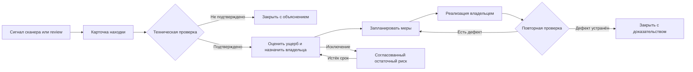

# Регламент управления уязвимостями банковского API

**Объект:** микросервис переводов и истории операций.  
**Область работ:** выявление, оценка и планирование обработки недостатков безопасности. Изменения исходного кода не выполняются.

## 1. Контроль безопасности при изменениях сервиса

Безопасность должна проверяться не только перед публикацией новой версии. Для каждой стадии разработки устанавливается результат, который можно проверить при переходе к следующей стадии.

| Контрольная точка | Что проверяется | Артефакт / условие перехода |
|---|---|---|
| Постановка задачи | Требования к доступу, сохранности денежных средств и конфиденциальности | Критерии приёмки безопасности |
| Архитектурное решение | Потоки данных, доверенные зоны, STRIDE, сценарии злоупотребления | Актуальная DFD и реестр угроз |
| Pull Request | Авторизация, операции с балансом, секреты, результаты Semgrep | Review и JSON-артефакт SAST |
| Тестовая среда | Изоляция данных клиентов, параллельные переводы, конфигурация хранилищ | Протокол проверок QA/AppSec |
| Решение о релизе | Открытые риски, результаты повторных проверок, исключения | Разрешение на выпуск или блокировка |
| Эксплуатация | Аномальные операции, инциденты, новые уязвимости | Обновлённый реестр и задачи реагирования |

## 2. Каналы обнаружения

Semgrep используется для проверки исходников по набору правил; JSON сохраняется без изменения как исходное доказательство. Ручная проверка необходима для дефектов, связанных с бизнес-логикой: сканер не всегда способен определить, соответствует ли запрошенный банковский счёт текущему клиенту.

В качестве дополнительных контролей предлагаются SCA для зависимостей, поиск секретов, проверка Docker Compose и других IaC-конфигураций, DAST в изолированной среде, а также анализ модели угроз. Эти методы не считаются выполненными только потому, что включены в регламент.

## 3. Маршрут обработки находки

Состояния записи: `New` → `In triage` → `Confirmed` → `Assigned` → `Ready for retest` → `Closed`. Для неподтверждённых результатов применяется `False positive`, для согласованных исключений — `Risk accepted` с датой пересмотра.

### Содержание карточки

| Группа данных | Обязательные поля |
|---|---|
| Идентификация | ID, название, CWE, связанная угроза, источник |
| Доказательства | Файл, строки, версия кода, описание условия возникновения |
| Оценка | Вероятность, воздействие на банковские операции, приоритет |
| Обработка | Ответственный, рекомендуемая мера, срок, статус |
| Проверка | Критерий устранения, результат повторного теста, дата закрытия |

Ручная запись IDOR должна быть явно помечена как `manual`, чтобы её нельзя было принять за автоматическое срабатывание Semgrep. Исходный JSON сканера хранится отдельно от дополненного реестра.

## 4. Правила триажа

1. Проверить фрагмент кода и путь данных от входа API до защищаемого ресурса.
2. Установить, возможна ли реализация дефекта при предусмотренной конфигурации и какие предпосылки необходимы.
3. Сопоставить записи с одинаковой первопричиной, не завышая число независимых уязвимостей.
4. Оценить доступ к чужим данным, вероятность некорректного списания и влияние на доступность сервиса.
5. Зафиксировать решение и передать подтверждённый риск ответственному.

**Пример: динамический SQL.** В `app/crud.py:61–66` строка запроса собирается динамически, но в неё подставляется только внутренний номер параметра; `search` и `limit` передаются отдельно. Поэтому наличие f-string не является доказательством CWE-89. SQL Injection в рассмотренном коде не подтверждена.

**Пример: IDOR/BOLA.** В `app/security.py:3–13` идентичность определяется недоверенным `X-User-Id`. Проверки владельца в `app/crud.py:5–13` и фильтр истории в строках 52–66 используют полученный идентификатор. Это связанный дефект аутентификации и объектного доступа; самостоятельный обход проверки владельца не установлен.

## 5. Приоритеты и допуск к релизу

Предлагаемые внутренние сроки обработки отсчитываются от подтверждения находки. Они не являются нормативными требованиями.

| Приоритет | Целевой срок | Правило выпуска |
|---|---:|---|
| Critical | 24 часа | Релиз блокируется до устранения или формального принятия риска |
| High | 7 календарных дней | Не выпускать без устранения либо согласованного исключения |
| Medium | 30 календарных дней | Задача включается в план работ |
| Low | 90 календарных дней | Устранение в рамках планового обслуживания |

Исключение утверждает владелец сервиса совместно с ответственным за безопасность. Оно содержит причину, компенсирующие меры, допустимый остаточный риск и конечный срок. Истечение срока возвращает запись на триаж.

## 6. План обработки для данного микросервиса

| Область риска | Приоритет | Кто обрабатывает | Критерий приёмки |
|---|---|---|---|
| Недоверенная идентичность и IDOR | Critical | Backend, AppSec | Пользователь не может читать чужую историю или списывать средства с чужого счёта |
| Конкурентное списание | Critical | Backend, DBA | Параллельные переводы не нарушают ограничения баланса и финансовую сверку |
| Доступ к PostgreSQL | Critical | DevOps, DBA | Реквизиты вынесены из репозитория, роль ограничена, прямой доступ извне закрыт |
| Доступ к Redis | High | DevOps | Аутентификация, ACL, защищённый канал и изоляция |
| Некорректное использование кеша | Medium | Backend | Cache hit и инвалидация возвращают актуальную историю |

Разработчик отвечает за исправление кода, DevOps — за конфигурацию и сетевые границы, DBA — за роли и ограничения данных. QA проверяет функциональность и регрессии, AppSec подтверждает находки и результат повторной проверки. Владелец продукта принимает решение о приоритетах и остаточном риске.

## 7. Условия закрытия и контроль эксплуатации

Для закрытия необходимо повторить SAST, проверить изменённый фрагмент и провести тест, соответствующий первоначальному сценарию угрозы. Для IDOR это отрицательные межпользовательские тесты, для гонки — конкурентные переводы, для хранилищ — проверка сетевых ограничений и ролей. Результат прикрепляется к карточке. Если дефект остался, задача возвращается исполнителю.

Операционный контроль включает аудит денежных операций, анализ аномалий и повторное моделирование угроз при изменении архитектуры. Для оценки эффективности процесса используются число открытых Critical/High, доля нарушений SLA, MTTR, повторные находки, доля false positive и охват SAST.

## 8. Границы подтверждения

Статические выводы сверены с `microservice.zip`. В предоставленном отчёте указаны Semgrep 1.186.0, 11 правил, 8 проверенных файлов, 12 автоматических находок и одна ручная IDOR; исходный JSON этого запуска не приложен к текущему комплекту, поэтому эти показатели приведены со ссылкой на исходный отчёт, а не как результат нового запуска. Динамические проверки, реализация контрмер и повторное тестирование не проводились.

Сопроводительный документ: [техническая оценка безопасности](security-assessment-report.pdf).

**Материалы:** `microservice.zip`, предоставленные `secure-sdlc.md` и `analysis-report.pdf`.
